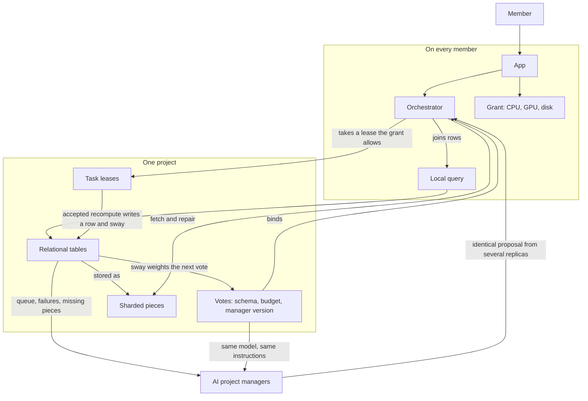

# Banner — design brief for peer review

Status: October 2026. Repository: https://github.com/Infernal-Insights/banner

This document is the whole design. It does not assume the reader has seen the chat that produced it. Review the design. Do not treat unbuilt sections as implemented.

## What it is

Banner is a distributed computer shared by the people who joined a project. A project is software, a model, or a campaign that needs CPU, GPU, and disk. Public-record work is in scope when the output is a map a second computer can rebuild from the same files. The output is not a verdict.

A member points their own machine at a project. Finished, checked work is that member's say in the project. The say is called sway. Sway is not a coin, not a token, and not transferable. The repository does not mint one.

The intended users are people who will contribute a computer to a goal that is itself a computing job: building a client, training or running a small model, reading and linking public records. A physical study that cannot be finished by compute is out of scope.

## What is built

Only the acceptance rule, on one machine.

- A signed append-only log (`log.jsonl`). Replaying it rebuilds state.
- Ed25519 signatures via OpenSSL. Private keys stay on disk at mode 0600. The log stores the public half.
- One charter, opened by one node. In this cut only that node may post leases.
- A lease names its attestor before anyone can claim it. The attestor cannot be the worker.
- The stand-in task is a pure function (`banner-tile:1` in `banner/tile.py`). Same seed and coordinates always yield the same bytes. A second node recomputes them. Matching sha256 accepts the lease and increments that worker's sway by one. A mismatch reopens the lease and does not move sway.
- A lease that outlives its ttl reopens. Expiry is the only unsigned event.
- A local status page and a CLI. Tests cover role violations, bad hashes, expiry, replay, and bad signatures.
- A static site in `site/` (home, an example project, a desktop mock, a create-project form that only downloads a JSON file, a public roadmap). It is a billboard. It is not a replica and it does not talk to a chain.

The stand-in task is named "Reef map" inside the reference client. That name is a test pattern so two machines can prove they produced the same bytes. It is not a project anyone is asked to join, and it is not the product.

Not built: a network, peer discovery, containers, a desktop installer, a contract, sway decay, elections, storage, a database, an AI manager, Vast, or MetaMask.

## The machine

Every member runs the same app. The app is a node in each project that person has joined. A project is the set of nodes that have granted it something, plus the signed log of what those nodes have accepted.



Six parts:

1. **CPU and GPU compute.** A task names which it needs. A node takes it only if that person granted the device. A different node runs it again. Agreement writes the result.
2. **Sharded storage.** Files and tables are pieces with hashes, spread across granted disks with two parity pieces, fetched from several holders at once. A challenge proves a piece is still there.
3. **A relational database with no server.** One voted schema per project. Rows live in those sharded tables. A payment, a file, a task, and a worker are rows that point at each other. Any node can join them locally.
4. **A non-AI orchestrator.** Ordinary software in the app on every member. It places work, repairs shards, rejects a bad hash, and refuses a task that breaks the schema or the budget. It keeps running when the model is offline or wrong.
5. **AI project managers.** Opt-in replicas of one small model and one instruction text. They read the database and propose. They do not accept.
6. **Sway.** A per-project counter on the worker key, written only when work is accepted. It weights later votes. It does not transfer.

## Two keys

The **worker key** lives in the app, encrypted, on that computer. It signs claims, results, storage challenges, and proposals. Sway accrues to this key, on that project only. Losing the machine without a backup loses the sway. That is accepted. Sway is a record of who showed up recently, not savings. Half-life is specified as 30 days once a contract exists. More accepted work refreshes it. Buying ETH does not.

The **personal key** is a normal Ethereum account. MetaMask is the default pen. It signs ballots and sends ETH into a project escrow. It does not hold sway. Once, the two keys sign the same linking sentence in opposite directions. After that, a ballot signed in the browser carries the fresh sway of every linked worker. Unlinked sway still counts inside the app, where the worker key signs for itself.

An optional later soulbound receipt may mirror sway so a wallet can display it. The contract rejects `transfer`. If a market appears, the protocol ignores it.

## How work is accepted

A lease is an exclusive claim on one task, with a ttl and a named attestor, committed before the claim.

1. Someone posts a lease for an image the project has already allowed, and names the attestor.
2. A worker whose grant fits claims it, runs it with no host network, heartbeats, and submits the output hash.
3. The named attestor runs the same inputs. Matching hash accepts. Mismatch rejects and reopens. Three rejects on one project sit that worker out of that project for a while.
4. Acceptance writes sway for the worker and, once tables exist, writes the rows that record the task, the output file, and the links.

The chain, when it exists, checks signatures and the hash commitment. It does not rerun the file. Full recompute is the right check when the task is cheap, which includes parsing a public file. A challenge window and a bisection down to one step are reserved for tasks too expensive to run twice up front. A zero-knowledge proof is a later way to show a contract that a recompute already matched. It is not required for the vote, and it is a poor fit for home GPUs. Hardware attestation (Intel TDX, AMD SEV-SNP, Nvidia confidential mode) can show that a host could not read memory. It does not show that the right program ran. It is not the acceptance rule. Most of the GPUs this network wants to use cannot produce that attestation anyway.

Tasks must be deterministic. Same inputs, same bytes. A GPU kernel that does not replay bit for bit cannot be accepted by hash. That constraint is load-bearing and unsolved for general GPU work.

In the product, any member may post a lease that uses an already-allowed image. The reference loop does not do this yet. There, only the node that opened the charter can post.

## The orchestrator

Not a model. Not Kubernetes. One supervisor inside the desktop app.

It watches each joined project's queue, starts a lease only if the grant has a free device, runs the pinned container, heartbeats, and stops the container when the lease ends or the owner pauses. An empty queue releases CPU and GPU even if the switch stays on. A second project may borrow devices that are currently released, unless the owner pinned them. A GPU granted to one project is off for the others. Cores may be split.

The app does not open a listening port. It pulls leases from any peer that has them, not from a leader. The transport, NAT traversal, and peer discovery are not specified.

Defaults: idle-only, no GPU, no manager duty, until the owner opts in.

## The project manager

A manager version is three things: the instruction text, the model weights, and the parent version. Both files are named by hash. Every opted-in machine runs that exact version. A replica on an older version is ignored.

The model is small enough for one consumer GPU, or for CPU if the owner accepts it being slow. "Distributed" means many copies of one model, not one large model sliced across houses.

Replicas read the same public inputs: the charter, the current instructions, open leases, recent accepts and rejects, queue depth, failed checks, missing shards. They draft at temperature 0. A draft becomes a proposal only when a quorum of replicas produce the same hash. The quorum size is not specified. One machine having an idea is not the project speaking.

A proposal may slice the next piece of the stated goal into leases using already-allowed images, point at failed recomputes, or draft a note that mentions only accepted work. It may also draft the next manager version.

A proposal may not accept a result, ban a worker, raise a budget, install its own next version, or post to a social network.

Duty runs in lulls, on devices the owner granted, and stops when real work is waiting.

### Replacing the manager

Anyone with sway may propose an edit. The current manager may draft one too, under the quorum rule. Voters read the diff. The ballot is `adopt-manager`. Unexpired sway for and against is counted when it closes. More in favor adopts it. The same vote can restore an older version.

On adoption, the orchestrator stops posting proposals from the old version. In-flight drafts do not carry over. New weights must fit the storage budget and be fetched before a machine can manage again. Instruction edits are expected to be common. Weight changes are rare, and they ship in the same version so the two cannot drift.

## Votes

A ballot is a typed message, not a transfer.

```
banner-ballot:1
charter: <id>
action: adopt-manager
version: 3
cid: <hash>
expires: <unix>
```

Passing rule: more sway for than against among ballots that arrive before expiry. No default quorum. A project may raise its own threshold later, in the charter, not in a global parameter.

| Action | Effect |
|---|---|
| `adopt-manager` | Next manager version: instructions and weights together |
| `elect-keeper` | Who may publish a draft. Not required to post a lease |
| `allow-image` | A container digest members may run |
| `burst-budget` | Most ETH per day that may be spent renting overflow |
| `count-receipts` | Whether paid overflow is on |
| `admit-file` | A hash and a size allowed into storage |
| `storage-budget` | Most bytes, and most files, the project will hold |
| `adopt-schema` | Column layout every table must follow |

MetaMask is one way to sign. The worker key is the other. The contract reads sway. It does not move a token.

## Storage

Files stay in their original bytes, named by the hash of their piece list. This is a torrent. A download pulls different pieces from several holders, checks each hash, and drops a piece that does not match. A hostile peer can waste a connection. They cannot write bad bytes into the file.

Small files, including the charter and the log, are kept whole on at least three members. Large files are striped with two parity pieces (RAID-6 style, not RAID-5). One home machine being offline is normal, so one parity piece is not enough. A rebuilt piece must still match its hash. Parity is for survival. The hash is for integrity.

Proof of possession, not proof of replication, and not proof of space. The holder commits a Merkle root. A public random names a piece. The holder returns the piece and the path, signed by the worker key. A checker hashes the piece. Some challenges are a fetch: another member must actually receive the bytes. Possession without serving does not count. There is no sealing step. Sealing would hide the bytes the next task has to read, and it is too heavy for these machines.

A file is held only while enough members have answered a recent challenge to rebuild it. Below that, the project posts a store lease.

Empty disk earns nothing. Plots earn nothing. Filecoin proof-of-replication, WindowPoSt, and Chia-style proof-of-space are not used. A project may later pay a Filecoin provider in ETH to hold a cold copy, the way it may pay Vast for compute. That provider earns no sway.

### What stops junk

Piece hashes do not stop junk. They only prove a download matches the file that was named.

A file is admitted only as:

- the charter or the log, or
- the input or the accepted output of a task the project already posted, or
- an `admit-file` ballot naming the hash and the size.

The project has a storage budget: a maximum number of bytes and a maximum number of files. A proposal that does not fit is not downloaded, not challenged, and not sway. Raising the budget or dropping a file is itself a vote. A proposal is a hash and a size, never the bytes. One worker key may only propose so many per day, so the log is not the spam channel.

The budget does not stop a majority that already holds the sway. They can vote to raise it. That is the project changing its mind. They still cannot push unadmitted hashes onto members. The app only fetches files the project has named.

Storage sway is capped so a shelf of disks cannot outvote accepted work. The cap's formula is not specified. Decay applies.

## The database

There is no database server. A server would be a leader.

A table is an admitted file written by a task under the voted schema. The task reads source files the project already holds, sorts the rows, and writes them. A second machine must produce the same hash. A graph is a table of edges. Nothing is inserted by hand. Output that does not match `adopt-schema` is rejected.

Each app loads admitted table files into a local engine (DuckDB or SQLite). That engine is a cache. Two members agree when the same query returns the same rows, not when the database files are byte-identical. The signed log stays small: leases, ballots, and which table hash was accepted. It does not hold the rows.

This is a replicated, content-addressed relational store with local joins. It is not a live distributed SQL cluster with a query planner, transactions across nodes, or concurrent writers. Reviewers should say if that fails the requirement of "a distributed relational database that links the project together."

## If the leader disappears

A project survives because other machines already store the charter and the log, not because the founder's computer is on. The website is a billboard. Seizing the domain does not delete a replica.

New tasks do not wait on the leader once instructions and allowed images are voted. A keeper publishes notes. A silent or captured keeper is replaced by ballot, and that ballot does not need their signature. A seized key cannot rewrite an event other people already have. Until sway decays or a ballot lands, that key can still do what any member can do.

A country cut off from the internet does not erase the project for anyone outside it. People inside keep the last charter they stored and may keep working on a local network, or by carrying the log. When a path out exists, the outside log wins a conflict: a task already accepted outside is not accepted twice, and sway counts only for results the surviving log takes. If every replica was inside the cut, nothing outside has the project until someone carries a copy out.

MetaMask, a rollup, and Vast are unreachable inside that cut. Work that only needs the last voted rules does not need a ballot.

The merge rule is a sketch. There is no specified vector clock, no rule for two outside partitions, and no transport.

## Paid overflow

Vast.ai is a valve for a queue members cannot drain. ETH leaves a project escrow under a passed `burst-budget`. The rented machine runs the same image, passes the same benchmark before GPU work, and is paid. It starts with burst mode on so it refuses to sign ballots. It earns no sway. If rented work voted, sway would be for sale. The desktop app does not embed a Vast account.

## Desktop app

One installer, Windows and Linux first, then macOS. Tauri rather than Electron when a real installer is needed. It registers `banner://join/<id>`. Until then the reference client is the Python CLI. Each joined project is a container on a shelf: pitch, queue depth, cores, per-GPU switches, idle-only, manager-duty. The installer does not exist yet. The site says so.

## Build order

0. Done. Signed log, one charter, recompute, sway only on acceptance.
1. In progress. Static site and a charter file the author keeps. Cloudflare Pages. No wallet button, no fake installer.
2. Desktop shelf. Several projects, grants, quiet when the queue is empty. Still one machine and a local log.
3. The same transitions on a local Ethereum chain, then one existing rollup. The rollup orders events for anyone who can reach it. Every member also keeps the log. Worker key earns sway. Personal key signs ballots and funds escrow. Decay. `adopt-manager` and the other ballots. A lease that matches voted rules does not need the leader's key. A local log from inside a cut can be merged later.
4. OCI images instead of the tile function. Rootless, no host network. A short-lived benchmark certificate before GPU work. Verifier still named before the claim.
5. Orchestrator grows up: exclusive GPUs, borrowing, pause, heartbeat, three-reject sit-out, disk grants, piece hashes, parity, challenges, store leases, capped storage sway.
6. ETH escrow and Vast overflow.
7. Manager replicas, quorum proposals, version voting.
8. Elect the keeper. Notes publish by vote. The project page is the recruiting post, and it may only mention accepted work.

Explicitly out of scope until the above works: a new L1, a tradeable vote, Kubernetes on home PCs, a model that judges quality without a recompute, a manager that posts to a social network by itself, slicing one giant model across houses, sector sealing, proof-of-space plots, sway for empty disk.

## Invariants a review must not quietly reverse

- Sway is not transferable. There is no pool. A rented machine cannot buy a vote by existing.
- Acceptance is a recompute of a deterministic task, or a later proof that such a recompute already happened. A model does not accept.
- The manager proposes. The orchestrator places and rejects.
- The manager cannot install its own next version.
- Unadmitted bytes are not stored and do not earn sway.
- The website and the founder are not the copy that counts.
- Home nodes do not run Kubernetes.

## Known gaps, in the order a reviewer should press

1. **Determinism.** General GPU work and LLM decoding do not replay bit for bit. Temperature 0 does not guarantee two replicas emit the same bytes. The quorum rule depends on them doing so. If they cannot, the manager never speaks, or the rule gets weakened until one replica is the leader.
2. **The database is not a distributed SQL database.** It is hashed table files plus a local cache. Concurrent writes, indexes, and joins that are not pre-materialized are unspecified.
3. **No network.** "Pull from any peer" without a port, a discovery protocol, or NAT traversal is unfinished. A rollup can order events and still not move a 2 GB file.
4. **Possession is not a unique replica.** A holder can answer a slow challenge by downloading the piece from someone else. Filecoin seals to prevent that. This design refused sealing. The deadline that would make cheating irrational is not specified. Three holders who are actually one person are a sybil the piece hash will not catch.
5. **Storage-sway cap, AI quorum, challenge period, and sit-out duration are unnamed numbers.**
6. **Reference code contradicts the product.** Only the charter opener can post leases. A node points at one project. The product says neither.
7. **Partition merge is one sentence.** "The outside log wins" fails when there are two outsides, or when the cut is the one that holds the only copies.
8. **Sybil.** New worker keys that do real work earn real sway. That is intended. Many keys, one person, is also intended to be possible. Nothing binds a person to one worker except the optional MetaMask link, and that link is voluntary.
9. **Majority capture.** A sway majority can admit junk, raise the budget, allow a malicious image, and install a manager that proposes only that image. The budget is not a defense against the voters.
10. **Discovery.** A stranger finds a project through a website, a link, or someone handing them a hash. There is no specified index that is itself hard to seize.
11. **Truth versus bytes.** For a records project, a matching hash proves two machines ran the same program on the same file. It does not prove the file was accurate, current, or that anyone committed a crime. The design says the output is documents and links. A reviewer should check that no later phase lets the manager declare guilt.
12. **Ordering dependency.** One existing rollup is a sequencer. Members keep replicas, but a ballot cannot close where the chain cannot be reached.

## What the reference client actually does

Python 3.10, OpenSSL 3, no packages. `python -m banner demo` creates three keys, opens a charter, posts four leases, has the worker render them, has the attestor recompute them, and leaves that worker with sway 4. A tampered signature is refused. Details are in `docs/LOOP.md`. The build order is in `docs/ROADMAP.md`. This brief supersedes neither file. It is the map of the system those files are building.
